  <a href="https://clararui.github.io/">个人网站 / Website</a> &nbsp; · &nbsp;
  <a href="https://github.com/Clararui?tab=repositories">项目仓库 / Repositories</a>

## 关于我 / About me

我是**第青川**，一名 **AI PM**。AI 原住民，专注 **AI 测评｜AI 提效**。

I'm **第青川 (Clararui)**, an **AI PM** and AI native, focused on **AI evaluations and AI-powered productivity**.

## 精选项目 / Selected projects

| 项目 / Project | 简介 / Overview | 入口 / Links |
| :--- | :--- | :--- |
| **YouTube Digest · Notes** | 基于 YouTube Digest 改造的 Chrome 学习插件，支持双语字幕、词汇查询和分类笔记。 A personal adaptation of YouTube Digest with bilingual transcripts, word lookup and categorized notes. | [说明 / Guide](https://clararui.github.io/youtube-digest-notes-extension/) [源码 / Code](https://github.com/Clararui/youtube-digest-notes-extension) |
| **AI builders daily** | 整理 AI builders 的公开内容，提供 HTML 日报与往期归档。 Public-source AI builder summaries, with HTML editions and an archive. | [阅读 / Read](https://clararui.github.io/ai-builders-daily/) [源码 / Code](https://github.com/Clararui/ai-builders-daily) |
| **轻颜 · 光影空间** | 使用 Three.js 与 GSAP 构建的黑银色沉浸式 3D 网页视觉作品。 A black-and-silver 3D web experience built with Three.js and GSAP. | [体验 / Demo](https://clararui.github.io/qingyan-light-space/) [源码 / Code](https://github.com/Clararui/qingyan-light-space) |

## Agent Skills

| 项目 / Project | 简介 / Overview | 入口 / Links |
| :--- | :--- | :--- |
| **会议助理 / Meeting assistant** | 将录音、转写初稿与课件整理为中文 Markdown 图文笔记，适用于课程笔记和会议纪要。 Turns recordings, draft transcripts and slides into illustrated Chinese Markdown notes for learning and meetings. | [源码与使用说明 / Code & guide](https://github.com/Clararui/meeting-assistant-skill) |

## 🏷️ 技能与标签 / Skills

### 产品

  
  
  
  
  

### 工程

  
  
  
  
  
  

